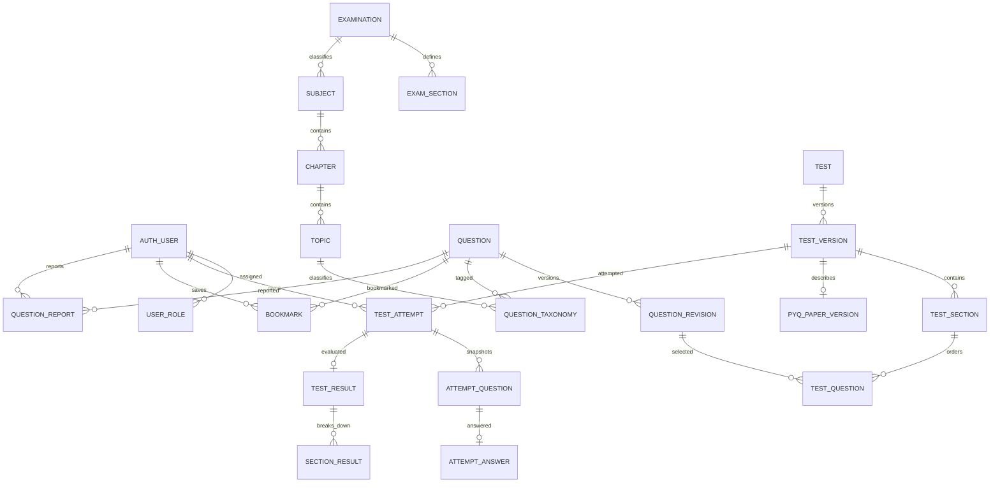

# NIMCET.XYZ Target Architecture

**Status:** Target design, not a statement of the complete live Supabase schema. The live database audit is recorded in `supabase-live-schema-audit-results.md`; Auth, Storage, migration history, and several catalog details remain pending.

## Goals and constraints

- Keep the current React/Vite student app and Supabase Auth working during the migration.
- Keep the existing `questions` table as the canonical identity for questions; PYQs and tests reference it rather than copying a second question bank.
- Put all protected administration, test timing, answer persistence, scoring, and result publication behind FastAPI.
- Preserve legacy columns and their meaning until the live schema and data have been inspected and a tested compatibility path exists.
- Make published test and question revisions immutable so that active and completed attempts have stable content, order, and marking rules.
- Keep the first deployment a modular monolith. Split services only if measured operational needs justify it.

## Runtime components and ownership

| Component | Owns | Does not own |
| --- | --- | --- |
| Student React/Vite app | UI, local navigation, countdown display from server timestamps, pending answer state, API calls, existing Supabase Auth UI | Official scores, permission decisions, canonical answer keys, attempt deadlines |
| Admin React/Vite app | Admin editing and preview UI, file selection, workflow feedback | Authorization, publishing authority, role assignment, direct protected DB writes |
| FastAPI modular monolith | Token verification, roles, validation, business rules, test sessions, timers, answer writes, submission/evaluation, media authorization, audit events | Authentication identity issuance (Supabase Auth remains the identity provider) |
| Supabase PostgreSQL | Canonical question data, test configuration, attempts, answers, results, roles, audit data | Browser-enforced permissions |
| Supabase Storage | Durable media objects identified by bucket and stable object path | Permanent signed-URL references |

### Backend domain modules

- `identity`: Supabase token verification, user profile lookup, trusted role lookup, ownership helpers.
- `catalog`: examination, subject, section, chapter, and topic metadata.
- `questions`: legacy adapter, rich content validation, question revisions, publication workflow, question search/detail.
- `media`: upload policy, object-path generation, access URL resolution, safe replacement/deletion.
- `pyq`: verified paper metadata and mapping to central question revisions.
- `tests`: test authoring, immutable versions, eligibility, schedules, and visibility.
- `attempts`: attempt creation, server clock, question/option order snapshot, answer autosave, navigation state, submission and evaluation.
- `student`: bookmarks, collections, reports, preferences, permitted analytics.
- `admin`: publishing actions, role-scoped management, audit log queries.

Keep route handlers thin. Pydantic request/response schemas validate transport data; services own business rules; repositories own SQL; a transaction boundary surrounds operations that must commit together.

## Request and identity flow

1. The student/admin app obtains a Supabase access token through the existing Auth client and sends it as `Authorization: Bearer <access_token>` to FastAPI.
2. FastAPI verifies the JWT signature against the configured Supabase issuer/JWKS (or a project-configured supported verification method), then checks issuer, audience, expiry, and subject. The accepted algorithm is configuration derived from the actual project; never accept an algorithm selected by the token itself.
3. FastAPI loads role assignments from trusted server/database state. User-editable `user_metadata` is never an authorization source. Any use of `app_metadata` must be controlled by trusted administrative tooling and match the verified project configuration.
4. Each request has a request ID and a transaction-scoped database context. Repositories constrain reads and writes by owner, publication state, and role; RLS provides a second boundary where correctly configured.
5. Responses contain only data allowed by the endpoint. In particular, test-session question data excludes answer keys, grading explanations, and internal revision fields.

### Database access strategy

Use SQLAlchemy with the PostgreSQL driver behind repositories and Alembic for schema evolution. The deployment must use a dedicated server-side database credential with the least privileges feasible. It must not use a Supabase service-role key in either frontend. If the selected Supabase connection mode bypasses RLS, backend services must enforce ownership/role rules explicitly and the database grant boundary must be documented; prefer a dedicated non-owner role plus transaction-scoped RLS context where the platform supports it. Validate the actual connection/pooling mode and role before Phase 3.

Never allow a client-provided user ID to select ownership. Derive actor ID from the verified JWT. For pooled connections, set and clear any request claims within the same transaction to prevent identity leakage across requests.

## Domain relationships



The ER diagram is logical. Exact SQL types, FK targets, and compatibility columns depend on live-schema review. Examination sections and academic subjects are separate children of an examination: the current 2026 `questions.section` and `questions.subject` labels overlap, but this does not establish that they are interchangeable or one-to-one. Map the legacy section field to exam sections and subject/chapter/topic classification through the academic taxonomy. Do not add a section-to-subject relationship until an official exam blueprint supports it. `test_sections` remain scoped to immutable test versions and are not the same entity as exam sections.

Catalog status is inherited through the hierarchy for student availability. A section, subject, chapter, or topic is selectable only when its own status and every relevant parent status are `active`; deactivation retains rows but excludes them from student-facing catalog/question queries. FastAPI repositories enforce the full ancestry filter.

FastAPI maintains catalog `updated_at` values explicitly on every update. PostgreSQL supplies insert defaults only; these catalog tables use no timestamp triggers.

## Rich question and option contract

Store content as a versioned JSON document validated at the API boundary and, where practical, against a database JSON schema/check. The same contract should later be generated/shared between Pydantic and the frontend. Unknown block types and arbitrary HTML are rejected.

```json
{
  "version": 1,
  "prompt": [
    { "type": "text", "value": "Solve the following equation:" },
    { "type": "math", "value": "\\frac{x+2}{3}=5", "display": true },
    { "type": "image", "asset_id": "8d9a...", "alt": "Equation diagram" }
  ],
  "options": [
    { "id": "opt-a", "content": [{ "type": "text", "value": "x = 7" }] },
    { "id": "opt-b", "content": [{ "type": "math", "value": "x=13" }] }
  ]
}
```

Contract rules:

- `version` is a positive supported integer; schema changes require a new version or explicit backward-compatible extension.
- `prompt` and every option `content` are ordered arrays of typed blocks. Supported v1 block types: `text`, `math`, `image`, `table`, `audio`, and `video`.
- Math block values are LaTeX source rendered by KaTeX with strict/error-safe handling; no HTML passthrough.
- Image/audio/video blocks reference a persisted media asset ID (which resolves to a stable bucket/object path); alt text/captions are explicit. No expiring URL is persisted in question content.
- Tables use structured headers/cells, not injected HTML. Images and diagrams must have safe approved raster/vector handling; reject arbitrary SVG/HTML uploads unless sanitized by a reviewed pipeline.
- Option IDs are unique within the question revision and remain stable through reorder. Correctness references option ID, not displayed index.
- A choice selection sent by the client is an option ID. An attempt snapshot stores the displayed option order so the same IDs remain traceable if the client shuffles options.
- Content validation checks block count, text/LaTeX length, table dimensions, attachment ownership, supported MIME types, and total payload size.

### Legacy adapter

The current frontend reads legacy `question`, `options`, and zero-based `correct_option`. Retain those fields initially. After live inspection, a backfill can translate each legacy row into a version-1 `question_revision` with deterministic option IDs derived from the question identity and legacy option position. Persist the mapping; do not regenerate IDs during reads. Verify every `correct_option` maps to exactly one option before making a revision publishable. Keep a compatibility view/adapter until all student reads use the new API. Do not change or drop legacy columns during the first migration.

## Test, attempt, and evaluation lifecycle

1. Editors create a draft test and question revisions. A publish action validates the whole configuration and creates an immutable `test_version` containing sections, ordered questions, per-question revision references, marks, negative marks, duration, attempt limit, schedule, visibility, and review policy.
2. Attempt creation checks verified identity, student eligibility, publication/schedule, attempt limits, and any prior active attempt in one transaction. It records server `started_at` and `deadline_at` and snapshots question order and option ID order.
3. An answer write uses a unique `(attempt_id, attempt_question_id)` row and optimistic `expected_version`; accepted writes increment the version. A stale request receives `409 answer_version_conflict` with the current version/value, never overwriting a newer answer.
4. Timer display derives from `deadline_at` returned by the server. The client clock is for display only. Server APIs reject writes after deadline according to an explicit configured grace policy; the default policy is no grace until a product decision is approved.
5. Submission locks/transitions the attempt and evaluates in a single database transaction. A unique submission/result constraint makes repeated requests return the existing terminal state. Timer-expired submission uses the same service path with reason `timer_expired`.
6. Evaluation reads the immutable question revisions and test-version marking rules. It stores totals, correct/incorrect/unanswered counts, per-section results, submission reason, and timestamps. Scores are never accepted from the client.
7. Result and answer/explanation endpoints enforce the test version's publication and review policy on every request, not only in the UI.

## Media lifecycle

- Admin upload is initiated through an authenticated backend endpoint. The backend validates role, extension, MIME sniffing, byte size, and safe file signature; it generates a non-user-controlled object path and records a pending asset.
- Upload can use a short-lived signed upload URL or backend proxy, based on verified Supabase bucket policies. The database stores bucket and object path only.
- The backend marks an asset ready only after verifying upload metadata. Content references an asset ID; question editing may only attach assets owned/authorized for that content.
- Publicly distributable question media may use a public bucket only after policy review. Private media uses authenticated/signed retrieval URLs generated on demand. Signed URLs never become database references.
- Replacement first updates references and then schedules deletion after confirming no remaining references. Orphan cleanup uses an age threshold, dry-run report, and audit record. Never delete an object solely because a client says it is unused.

## Authorization matrix

| Operation | Anonymous | Student | Editor | Administrator | Super administrator |
| --- | --- | --- | --- | --- | --- |
| Read published practice questions/solutions | Allowed only if live RLS/policy confirms | Yes | Yes | Yes | Yes |
| Read draft questions | No | No | Assigned scope | Assigned scope | Yes |
| Edit question drafts/media | No | No | Yes, scoped | Yes | Yes |
| Approve/publish questions | No | No | No by default | Yes | Yes |
| Build/publish tests and PYQ papers | No | No | Draft only if explicitly granted | Yes | Yes |
| Create private practice test/start eligible test | No | Yes | Yes as own user | Yes as own user | Yes as own user |
| Save answer/submit attempt | No | Own attempt only | Own attempt only | Own attempt only | Own attempt only |
| View results | No | Own, after release | Own, after release | Own, after release | Own, after release |
| Assign roles or change security config | No | No | No | No by default | Yes, audited |
| Review reports/audit data | No | Own report status only | Scoped reports if granted | Yes | Yes |

The exact role assignment mechanism is a trusted administrative workflow. Account signup and mutable user metadata never grant roles. Add least-privilege role scopes only when there is an actual editorial workflow requiring them.

## API and error conventions

- Prefix all business endpoints with `/api/v1`.
- Use JSON request/response bodies with Pydantic validation and OpenAPI generated from FastAPI.
- List APIs use `limit` and opaque or stable `page`/cursor pagination with a maximum limit; response includes `items`, `next_cursor`, and `total` only where an exact count is affordable.
- Standard error body: `{ "error": { "code": "...", "message": "...", "details": {}, "request_id": "..." } }`. Never include SQL, tokens, internal exception text, or correct answers in errors.
- Use `401` for missing/invalid identity, `403` for role/ownership denial, `404` for unavailable resources (including resources whose existence must not be disclosed), `409` for stale versions/state conflicts, `422` for validation, and `429` for rate limits.
- Writes that may be retried support idempotency or optimistic versions. Submission is idempotent by attempt ID; media creation uses an explicit client idempotency key.

## Observability and operations

- Structured logs include request ID, route, actor UUID where policy permits, entity IDs, status, and latency; never log tokens, passwords, full answer payloads, or signed URLs.
- Health endpoint checks process liveness only; readiness checks database connectivity and migration compatibility without exposing credentials or schema details.
- Audit events record actor, action, entity, timestamp, request ID, and safe before/after changes for administrative actions. Sensitive values are redacted.
- Render configuration supplies backend secrets; Vercel only supplies public frontend config and backend base URL. No service-role or database secret uses a `VITE_*` variable.

## Migration and rollout sequence

1. Capture live schema, policy, bucket, and representative-row inventory; keep a sanitized artifact in restricted project documentation if permitted.
2. Confirm exact `questions.id` type, `options` type/encoding, status values, uniqueness/indexes, RLS, and the `correct_option` convention. Confirm Auth linkage and storage ownership.
3. Create migrations against a non-production database cloned/sanitized from the real schema. Add new objects/nullable fields only; avoid renaming, dropping, type changes, or rewriting legacy meaning.
4. Add question-revision/content bridge and backfill in batches. Record source row counts and per-row failure reasons; do not silently skip invalid rows.
5. Add test, PYQ, attempt, student-feature, role, and audit tables in dependency order. Add FK indexes and unique/check constraints after data validation where necessary.
6. Deploy backend in read-only question compatibility mode, compare list/detail results against the current client, then migrate student reads gradually.
7. Enable writes and test-taking only after authorization, RLS, transaction, and concurrency checks pass in a non-production environment.
8. Retain rollback-compatible legacy reads until monitored parity and recovery windows pass. Production migration/deployment requires an explicit target and approval under the project rules.

## Open design and deployment decisions

- The legacy `questions.id` type (`bigint GENERATED BY DEFAULT AS IDENTITY`), sequence parameters, and constraint definitions are now verified in the live audit report. Migration history and a reviewed backfill remain required before adding any question FK.
- Complete deployed migration history, including reconciliation of `auth` and `realtime` metadata with the absent `supabase_migrations.schema_migrations` result.
- Production PostgreSQL default ACLs are verified for `postgres` and `supabase_admin`; the actual migration executor and backend runtime role privilege matrix remain pending. The disposable PostgreSQL defaults do not establish Supabase defaults.
- Supabase JWT signing configuration and whether the deployment will verify via JWKS or another supported key source.
- Database connection role/pooling configuration and feasible RLS context strategy.
- Official NIMCET marking values and grace/result-release policies, which must remain configurable until confirmed.
- Public/private media classification and actual bucket policies.
